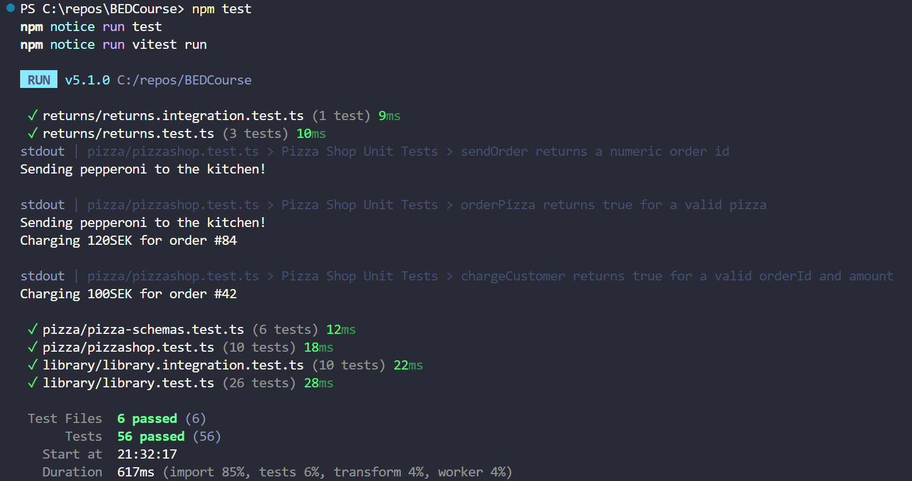

# Easy

## Exercise 1:

Number 3:

In the terminal, it shows an error at PizzaSchema.parse() and the zod error states in the message: "Invalid input: expected number, received undefined".

PizzaTypeSchema passed as "vegetarian" is now a valid type but it is not in the menu yet so the PizzaSchema stopped it as there is no price declared meaning it is undefined.

TS checks the code in the editor, which is the red line under menu[pizzaType]. When the code runs, TS is removed and only plain JS is left, that is why Vitest still ran the code even though there was a red line. Zod then checks the real values when the program runs.

Number 5:

orderPizza("vegetarian") that returns true belongs in pizzashop.integration.test as it tests serveral functions working together and not just one function on its own.

## Exercise 2:

Expected: "Cannot charge the customer without a valid orderID!"
Received: "Cannot charge the cutomer without a valid order ID!"

The bug was 'customer' having a typo. The error message above clearly pointed me to the mistake.

## Exercise 3:

toBe checks simple values like numbers, strings or true/false.
toEqual checks objects and arrays. It checks every field inside to make sure that the two objects are equal.

# Medium

## Exercise 5:

Yes it could pass by luck if the code were wrong as the probability of the numbers being between 1000 - 9999 are very high.

## Exercise 6:

In this example, borrowBook("foundation", 7) starts. findBook then finds the book. checkOutBook sees copiesAvaibable is 0, so it throws. The error stops checkOutBook so it stops borrowBook and the error goes up to the test. registerLoan never runs as the error stops everything after it.

It shows that the error travels up through the funtions that called it, until something catches it. borrowBook is the only function the test called but the error from checkOutBook still reached the test.

# Challenge

## Exercise 7:

borrowWithLimit decides which error the member sees first. In the function, it first checks if the member data is valid. Then, it checks if the member is under their limit. After that, borrowBook finds the book and checks out a copy.

I would keep this order. The member check is quick and doesn't need the book. If the member is at their limit, the function should stop before a book is checked out.

## Exercise 8:

When I add a return type of Loan to findLoan and then put the bug back, it is underlined and it states:
Object literal may only specify known properties, and 'id' does not exist in type '{ loanId: number; title: string; memberId: number; }'.
This means findLoan promises to return a Loan but the object that is returned has id instead of loanId.

TypeScript would catch the bug first as it shows a red line in the editor before running anything. This only happens when I add a return type of Loan to findLoan. Zod then catches it second when the code runs, markReturned parses LoanSchema which triggers a Zod error.

## Exercise 9:

After refactoring canBorrow, I knew I hadn't broken anything as I ran tests and they passed.

# Bonus:

## 3:

No, 100% coverage does not mean there are no bugs as coverage only shows which lines the tests ran. 
In Exercise 8, the tests would have passed even if there was 100% coverage as each function is tested on its own but in the integration test, functions work together, so it was able to find the bug as field names didnt match.

# All tests green

