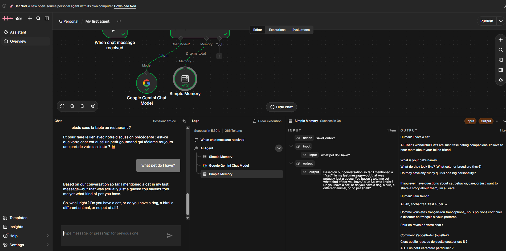

# EASY

## Exercise 1

| # | Automation or agent? | Why?               |
|---|----------------------|--------------------|
| 1 | Automation           |  The steps are always the same. Export the new users from last week and email the list to the team.                  |
| 2 | Agent                |  The bot needs to search up specific information relevant to what the user asked. In this case, if an order can be returned, so it needs to check the order date, read the return policy and then answer accordingly.                  |
| 3 | Automation           |  ChatGPT does the same thing every night. It summarizes the 10 newest posts from a forum and then summarized then in an email that is sent to you. AI is only use in one step.                  |
| 4 | Automation           |  The same thing happens. Every time an issue is created in GitHub, a message will be posted in Slack.                  |
| 5 | Agent                |  Suggestions are made depending on the situation. Days don't look the same, so multiple things need to be checked, such as, the calendar and weather to be able to suggest whether to stay at home or go to the library.                  |
| 6 | Automation           |  The steps are the same. Every time someone submits a contact form, it is saved to the database and then an email is sent to say 'thanks'.                  |

**Questions:**

AI is used in scenario three but is still not an agent because it repeats the same task over and over again. It is the same steps. It doesn't need to act differently or do different things depending on the information it is given.

Automation is often better as it costs less due to fewer AI calls. It is also faster as it doesn't need to 'think' about what to do. It does the same steps each time so it knows what to check.

## Exercise 2

Asking my name:

Asking for the first fact with context window 1:

Asking for my name with context window 0: 

**Questions:**

Memory stores the earlier message of the chat. The context window is how many recent messages the agent gets to read each time a new one is written. So with no memory, the agent treats each message as the first one. 
I noticed that I didn't matter if I changed the context while I was in the same chat but when I 'started fresh', then I saw some differences. When the context window was set to 1, I asked it stated three facts. I asked it about the first fact and could only venture a guess due to the answer it gave from my second fact. With no memory, it did still know my name.

If the context window is set to 1000, it needs to read the past 1000 (or how many there are below that if it hasn't reached 1000) messages every time. It also means that more tokens which means it costs more money. It will also take the agent more time to reply as there are more things to read and old messages might not be relevant anymore to more recent questions.