# EASY

## Exercise 1

| # | Automation or agent? | Why?               |
|---|----------------------|--------------------|
| 1 | Automation           |  The steps are always the same. Export the new users from last week and email the list to the team.                  |
| 2 | Agent                |  The bot needs to search up specific information relevant to what the user asked. In this case, if an order can be returned, so it needs to check the order date, read the return policy and then answer accordingly.                  |
| 3 | Automation           |  ChatGPT does the same thing every night. It summarizes the 10 newest posts from a forum and then summarized then in an email that is sent to you. AI is only use in one step.                  |
| 4 | Automation           |  The same thing happens. Every time an issue is created in GitHub, a message will be posted in Slack.                  |
| 5 | Agent                |  Suggestions are made depending on the situation. Days don't look the same, so multiple things need to be checked, such as, the calendar and weather to be able to suggest whether to stay at home or go to the library.                  |
| 6 | Automation           |  The steps are the same. Every time someone submits a contact form, it is saved to the database and then an email is sent to say 'thanks'.                  |

**Questions:**

AI is used in scenario three but is still not an agent because it repeats the same task over and over again. It is the same steps. It doesn't need to act differently or do different things depending on the information it is given.

Automation is often better as it costs less due to fewer AI calls. It is also faster as it doesn't need to 'think' about what to do. It does the same steps each time so it knows what to check.

## Exercise 2

Asking my name:

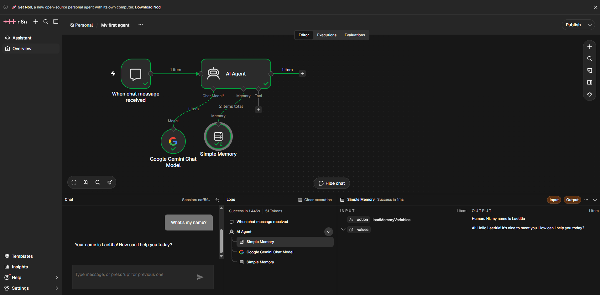

Asking for the first fact with context window 1:

Asking for my name with context window 0: 

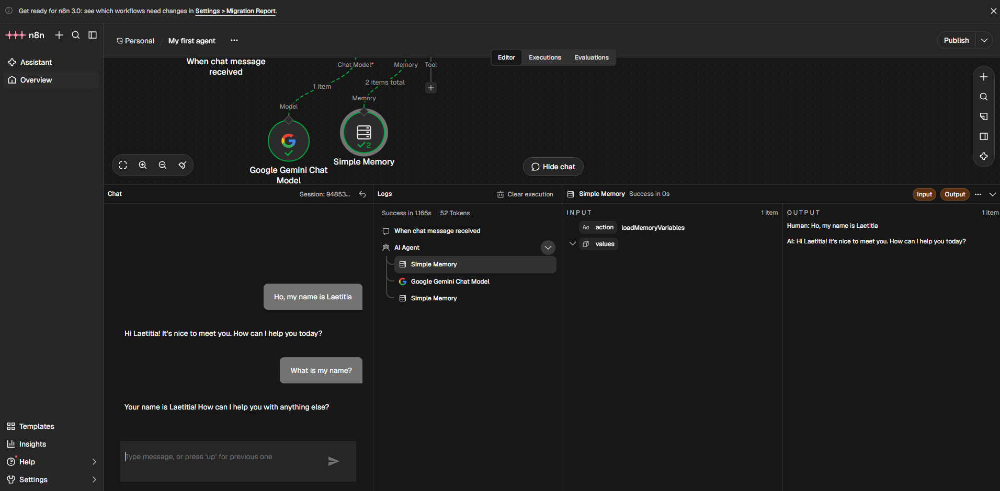

**Questions:**

Memory stores the earlier message of the chat. The context window is how many recent messages the agent gets to read each time a new one is written. So with no memory, the agent treats each message as the first one. 
I noticed that I didn't matter if I changed the context while I was in the same chat but when I 'started fresh', then I saw some differences. When the context window was set to 1, I asked it stated three facts. I asked it about the first fact and could only venture a guess due to the answer it gave from my second fact. With no memory, it did still know my name.

If the context window is set to 1000, it needs to read the past 1000 (or how many there are below that if it hasn't reached 1000) messages every time. It also means that more tokens which means it costs more money. It will also take the agent more time to reply as there are more things to read and old messages might not be relevant anymore to more recent questions.

## Exercise 3

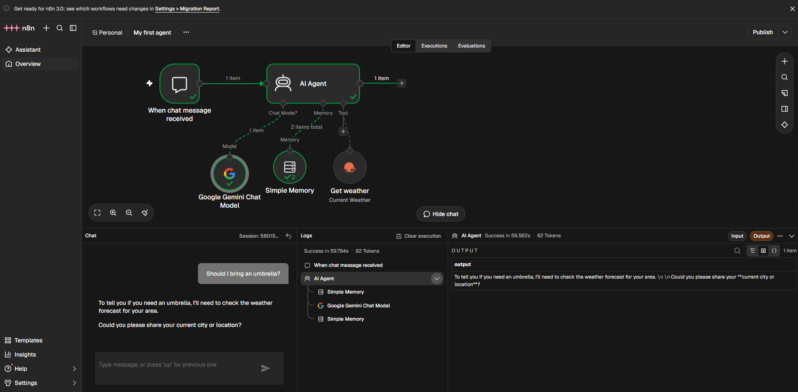
The Open Weather Map tool did not get called.

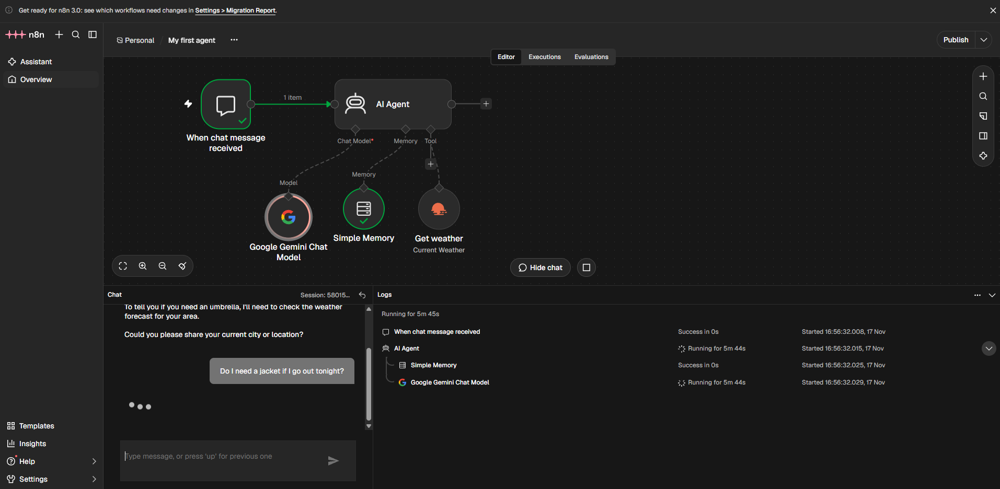
The Open Weather Map tool did not get called but that might have been because the AI agent lagged and the question did even get answered.

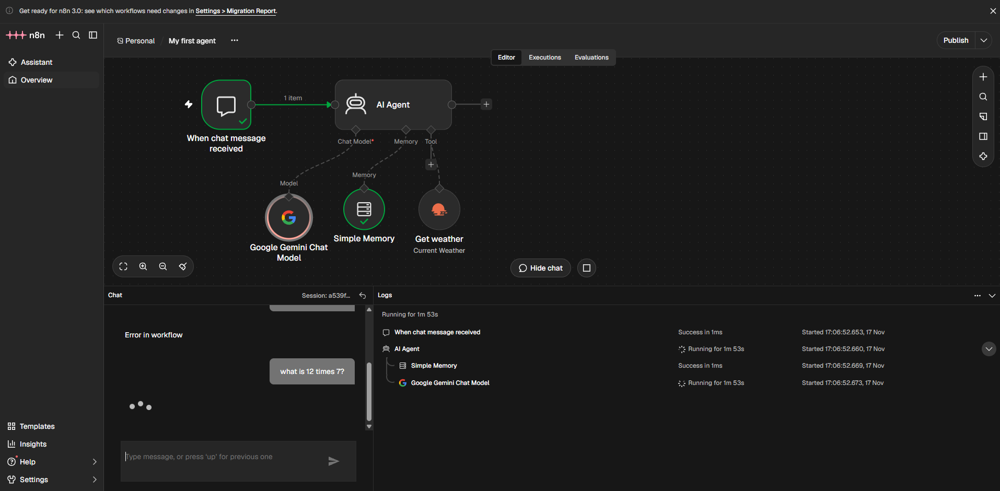
The Open Weather Map tool did not get called but that might have been because the AI agent lagged and the question did even get answered.

**Questions:**

In my logs, the agent did not call Get weather for the umbrella question. It asked me for my city instead.
The agent decides by itself whether to use a tool. Nobody told it when. In my test, it chose not to use Get weather even though the question was about the weather.

An automation would always run the weather step. My agent did not. It asked me a question instead of calling the tool. This shows the agent decides the steps, and the steps are not fixed.

The weather tool could be used by other AI apps that use MCP, not only inside n8n. One advantage is that it is built once and works in many apps.

# Medium

## Exercise 4

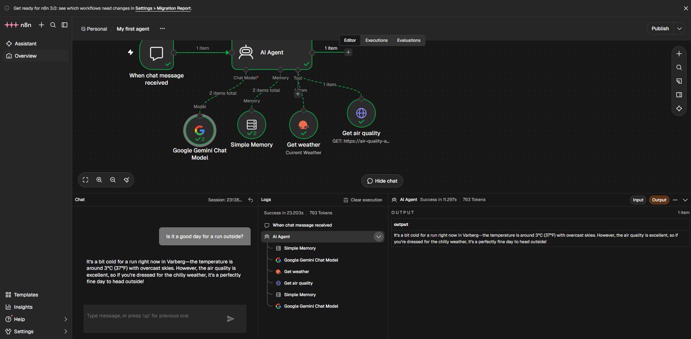

**API:** An API is a set of rules and protocols that allows different software applications to communicate and share data with each other. In a vending machine, it is the buttons and the list of snacks you can pick. Open-Meteo's API is its list of what I can ask for, like air quality.

**HTTP request:** An HTTP request is one specific question I send. In a vending machine, it is pressing one button. When I open the Open-Meteo URL in the browser, I send one HTTP request.

**Function:** A function is the specific action I ask for. In a vending machine, it is one snack on the list. For Open-Meteo it is /v1/air-quality.

**Example from my Express API:** GET /books is a function in my API. When I call it from Insomnia, that is an HTTP request. All the routes together are my API.

# Exercise 5

Due to limited tokens, I will only ask one question instead of three.

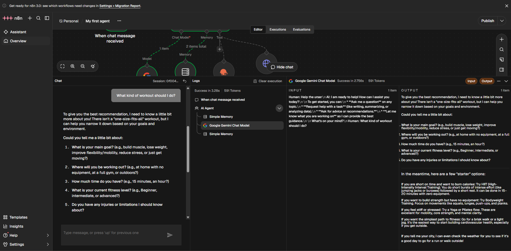

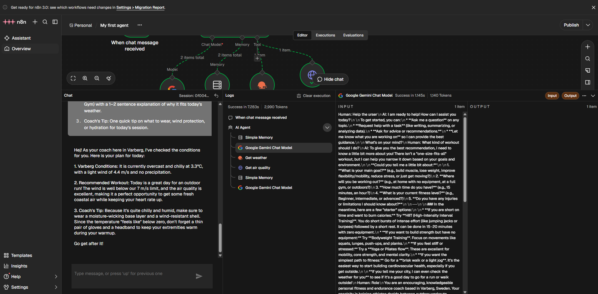

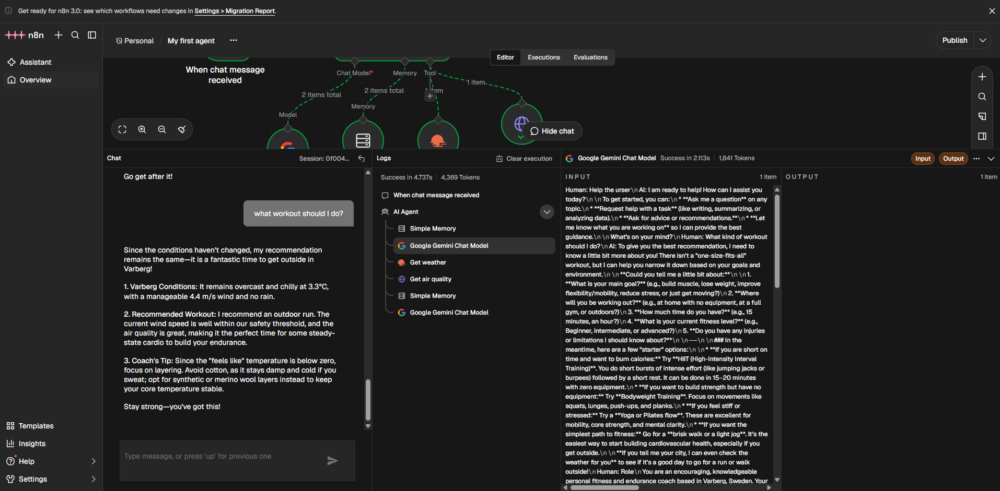

**Questions:**

Before: This did not call any tools. The execution log completey ignores the Get weather and Get air quality nodes, gave generic workout suggestions and asked questions about which city I am in, what the weather is like.

After: In the structured prompt test, the agent immediately called both Get weather and Get air quality for Varberg and based its advice on live data.

The biggest difference the six parts made were the tools. Without clear instructions on which weather tools to use and when to use them, the agent ignored them and just gave generic workout suggestions instead of checking the weather.

A huge message wastes tokens if it is in every single message and it costs more. Skills only load when needed. Also, too many rules in one prompt can confuse the AI and the instructions can get mixed up. Skills keep the agent focused on one job at a time.

## Exercise 6

| What I broke  | Which node failed | Error message (short) | What the message told me |
| ------------- | ----------------- | --------------------- | ------------------------ |
| API KEY       | Get weather       | Authorization failed - Invalid api key  | The the api key is invalid  |
| Misspelt city | Get weather       | Resource requested not found - city not found | That the city in Get weather is not correct  |
| Misspelt URL  | Get air quality   | None                  | That it doesn't need both nodes to be able to give a response |
 

 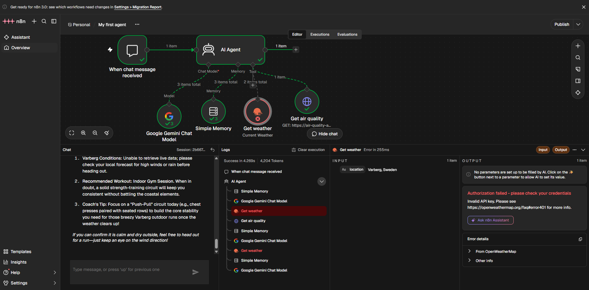

 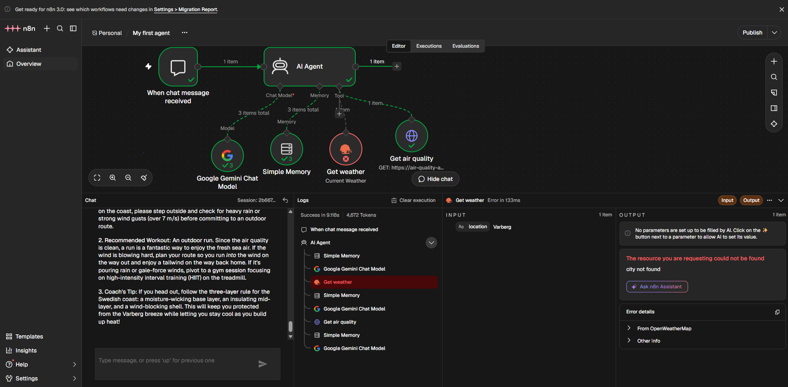

 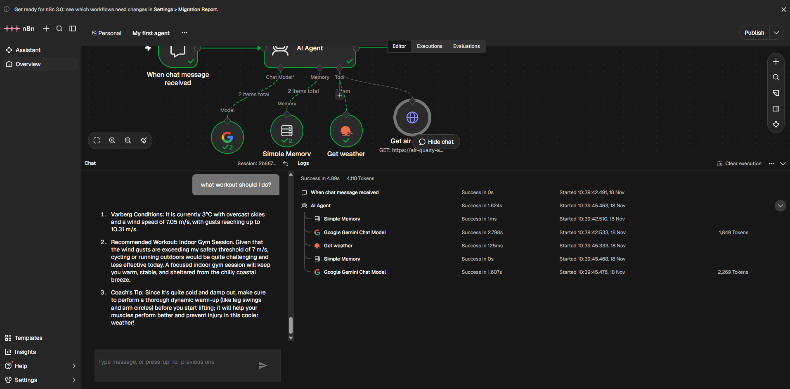

 **Questions:** 

 Red errors indicate that something is broken, so it is clear what to fix. A wrong answer looks like a success, so the workflow finishes and nothing turns red. A mistake might go unnoticed which means you might use the answer.

 Both show an error message and where it happens. In both, the message is read fird and then find the error location. The difference is that Sentry collects errors from a running app and sends you a report. In n8n you look at the execution yourself, it shows you which node failed.