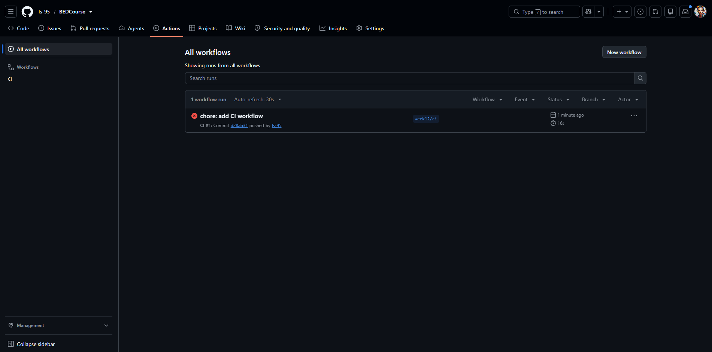
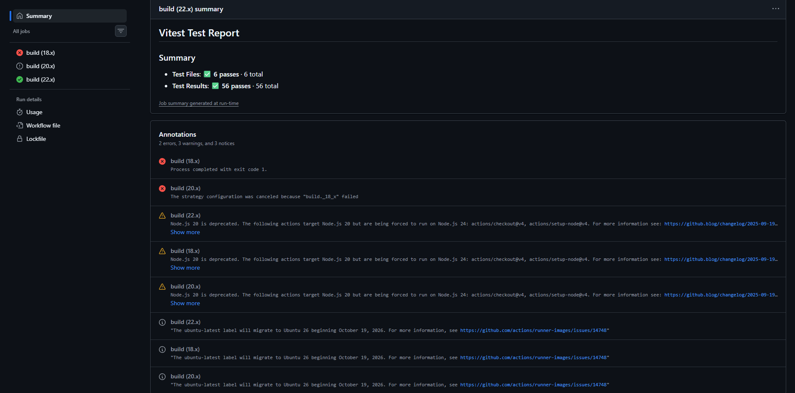
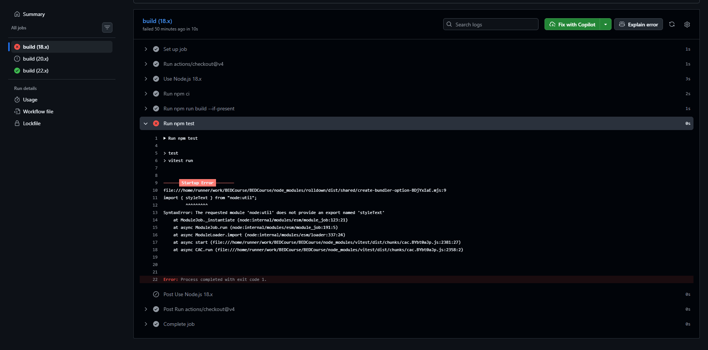
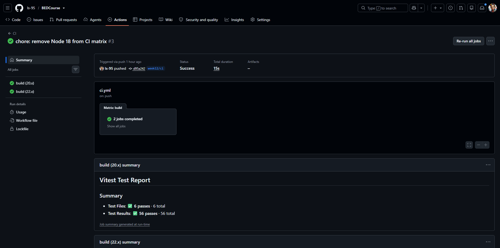
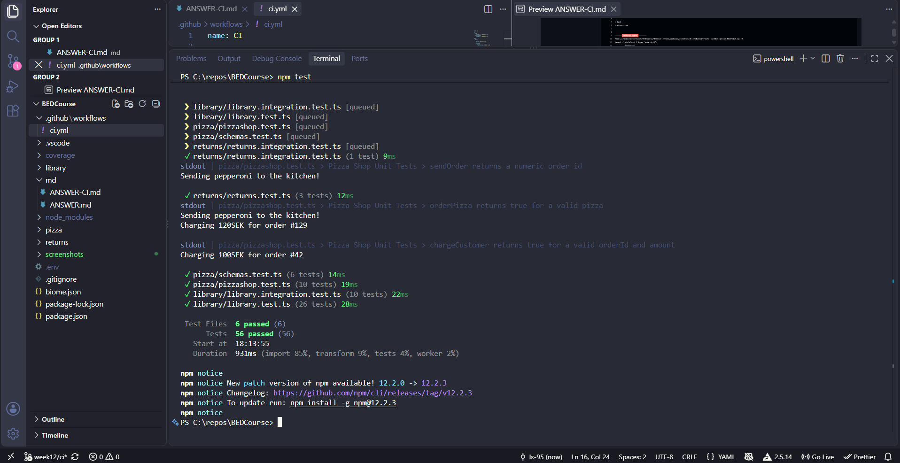
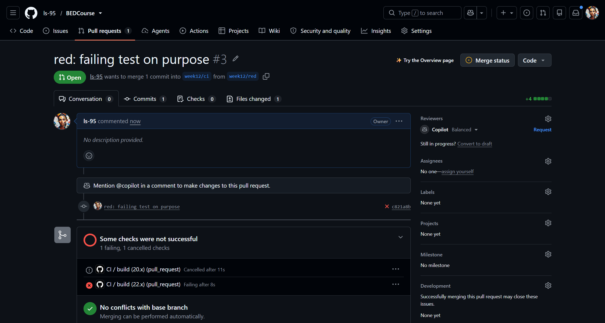
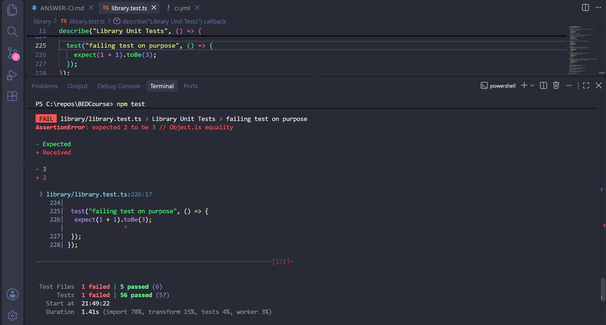
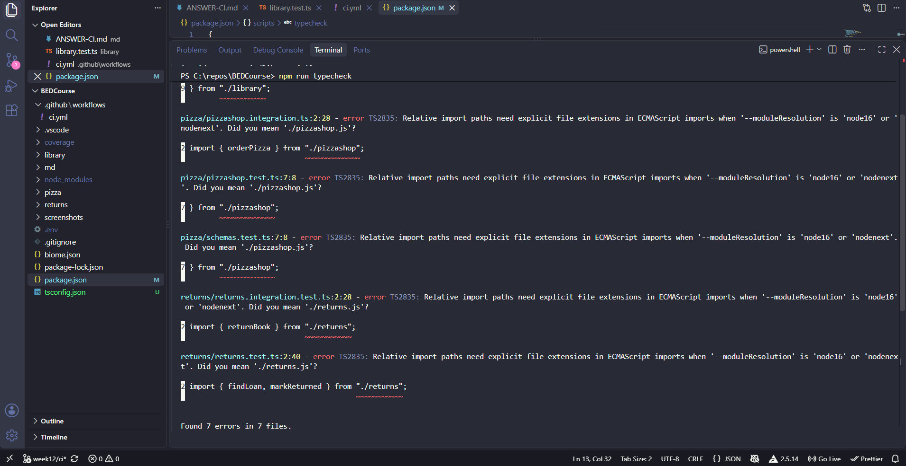
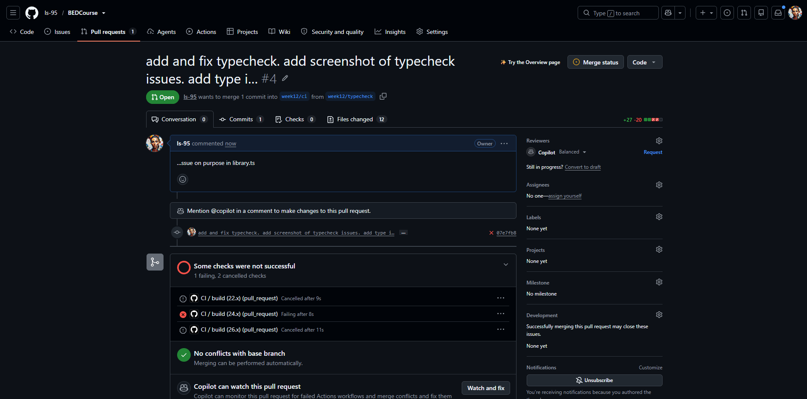
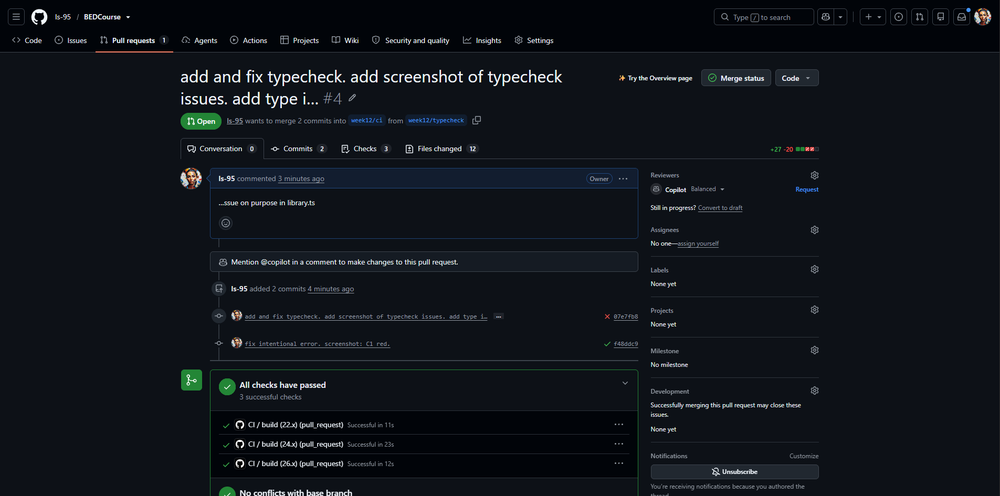

# Easy

## Exercise 1

**Question:**

**on** is used to define events that trigger a workflow. These events in this case are **push** and **pull_request**, both limited to the `week12/ci` branch.

**runs-on** is a setting in the workflow file. It tells GitHub which operating system to run your job on. So in thes case ubuntu-latest which is a version of linux.

**strategy.matrix**  is a way to run the same job several times. For us, `node-version: [18.x, 20.x, 22.x]` means that it will run the job three times, once with each Node version in the list.

**steps** is a list of tasks a job does, in order, from top to bottom. Two steps used are **uses** and **run**. **uses** runs a ready-made action that someone else wrote. **run** runs a command.

Something did happen for me. Pushing the branch started the workflow because the branch matched the `on` sectoin. The tests did run but the run failed. The node 18 job crashed because a package needs a newer node version. The node 20 job was cancelled because of that failure and the node 22 passed.

## Exercise 2

Two jobs ran, the Node versions 20 and 22. The reason why they ran are because both versions are defined in the strategy matrix in the ci.yml file. 

**Question:**

A test can pass on your laptop but fail in CI because the environment may be different. For example, different node versions. In my case, Node 18 caused the tests to fail. Once I removed it and kept only versions 20 and 22, ithe tests passed. 
Other possible reasons could be because of missing dependencies, different operating systems, file paths, case sensitivity or even timing issues.

## Exercise 3

**Question:**

It is better to know about the problem before the merge because then I can fix it on my branch. After merging, the broken code is already on the main branch and it is more complicated to fix.

## Exercise 4

**Question:**

