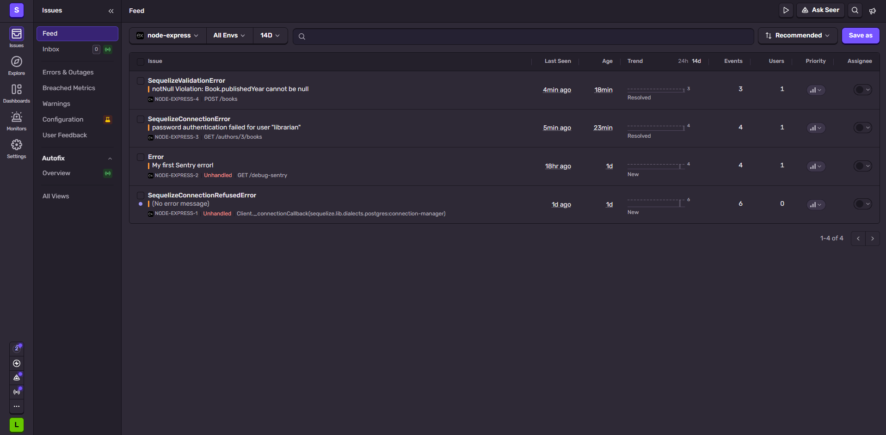
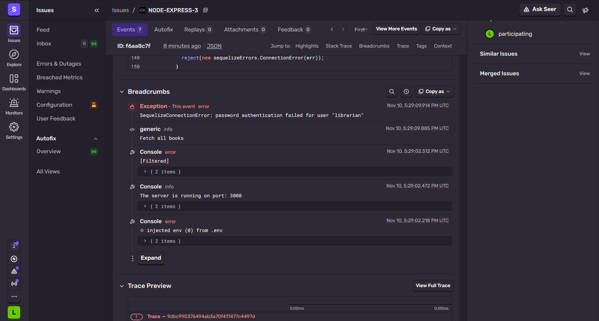
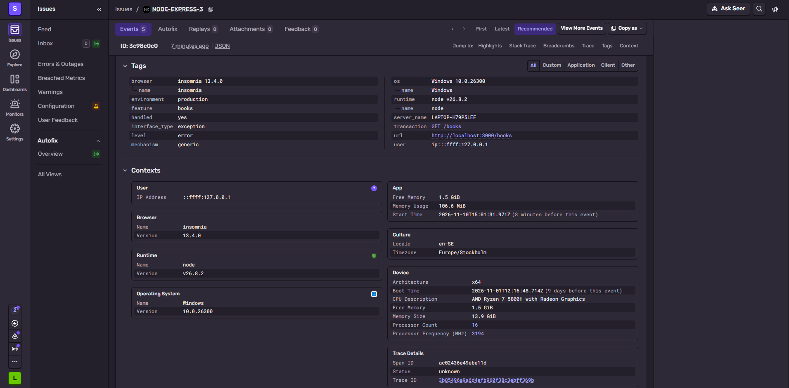
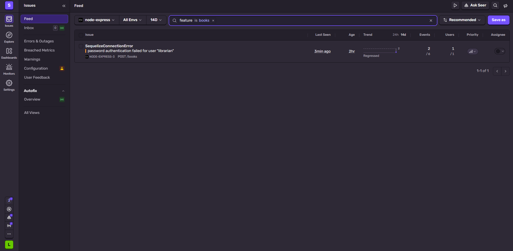

# Easy

## Exercise 1

instrument.js needs to be imported before everything else as it needs to run before the rest of the code loads so it can watch what happens (catch errors).

DSN is in the .env file (which is in the .gitignore file) as it is the information needed to access the Sentry project. Anyone who has it can send data to the project.

## Exercise 2

The information that Sentry has still recorded even without adding extra information is about the error, about the request and the visitor and then about the computer.

The information that is mentioned about the error is related to the error message, if the error has been handled and the stack trace (the file name and the line number where the error was thrown -> index.ts, line 47).

The information mentioned about the request and the visitor is the request itself (the method, url and the headers), the ip address and the browser used.

Then the information mentioned about the computer used is the operating system, Node.js version, environment, computer name, processor, memory, time of the error and the breadcrumbs.

## Exercise 3

When I moved the handler above the routes, I saw no difference and the error still arrived in Sentry, the event went up by one.

I think that the hanlder should be at the bottom, after the routes, as Express reads code from top to bottom. If the handler is above the routes, Express has already passed it before the error happens so it should not catch the error. That is why it needs to be at the bottom after all the routes.

# Medium

## Exercise 4

setupExpressErrorHandler only reports errors that weren't caught. The errors inside the try/catch blocks were caught and a 500 response was sent. Since they are already handled, they are not passed on.

Sentry grouped the failed requests into one issue not separate issues, as they all failed for the same reason (wrong db password). It is useful because instead of seeing so many entries for the same problem, I only see one. It would waste time to have to resolve each one separately.

## Exercise 5

A breadcrumb is a history of what happened before the error. So it is a 'trail of breadcrumbs' that lead up to the error. It logs the actions, network requests or console log message in the order to show the chain reaction.

Breadcrumbs can be helpful in a team as it will show exactly the moment, for example, an app crashes. Someone is buying a product online and when they click pay, the app crashes and the breadcrumbs will show all the events that lead up to that moment, so you can pin point the exact problem that happened.

A tag is a key value label attached to an error that will explain the environment. It will explain the characteristics of the error, what operating system was used, what browser, what server environment was used at the moment of the error.

Tags can help notice if there is a pattern in errors. Maybe it is the browser that is causing the crashed app and the same browser would appear in all of the issues. This can help the team fix problems faster.