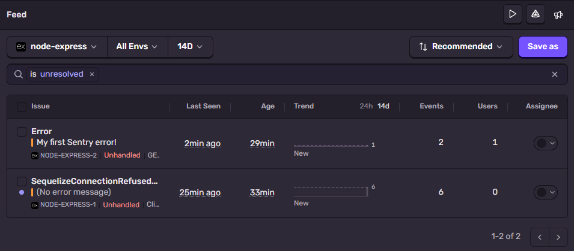
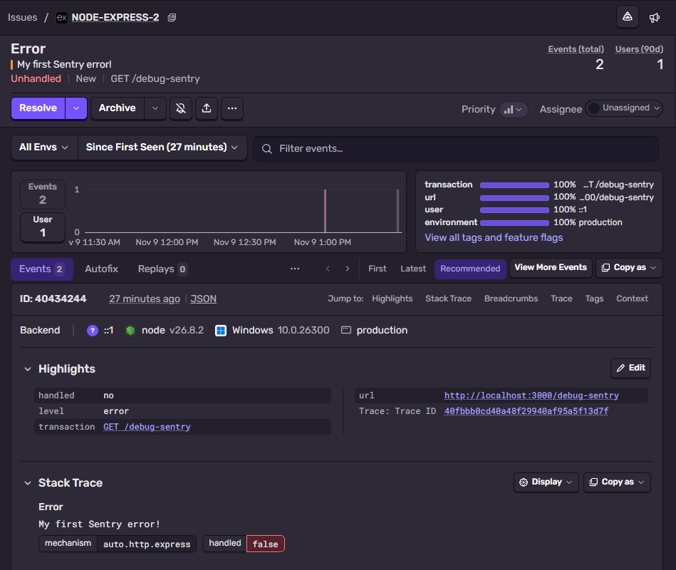

# Easy

## Exercise 1

instrument.js needs to be imported before everything else as it needs to run before the rest of the code loads so it can watch what happens (catch errors).

DSN is in the .env file (which is in the .gitignore file) as it is the information needed to access the Sentry project. Anyone who has it can send data to the project.

## Exercise 2

;

;