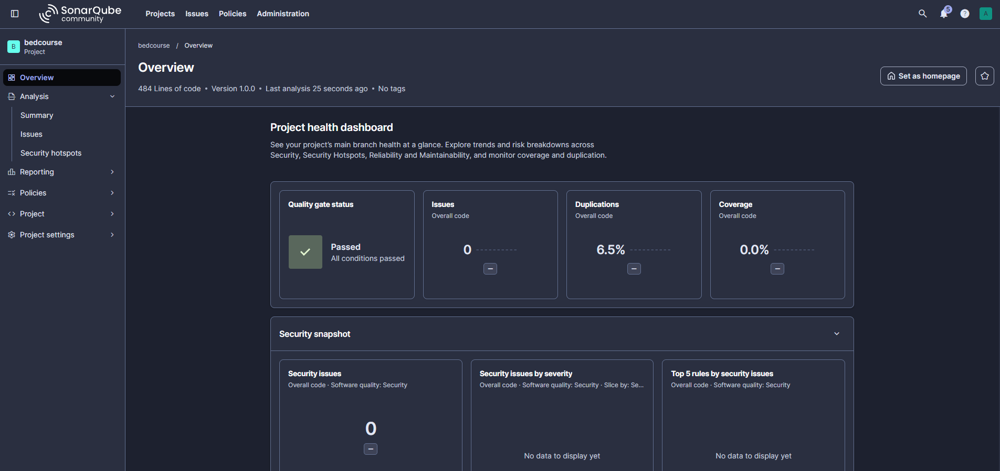
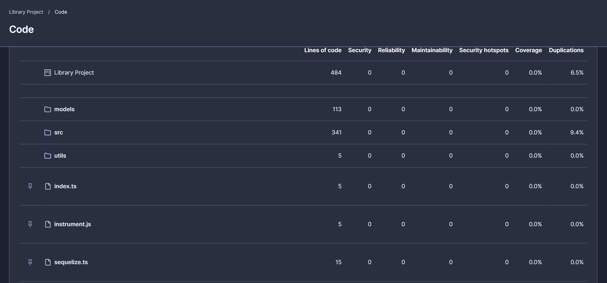
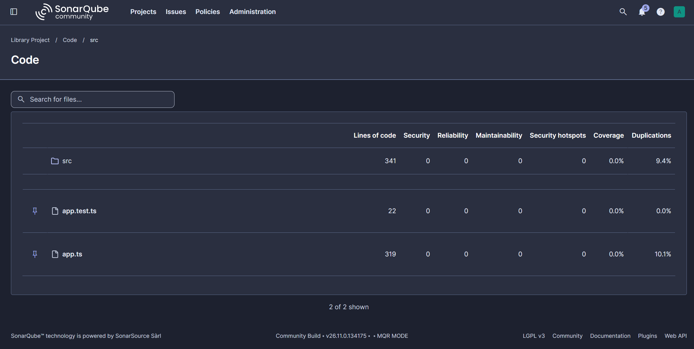
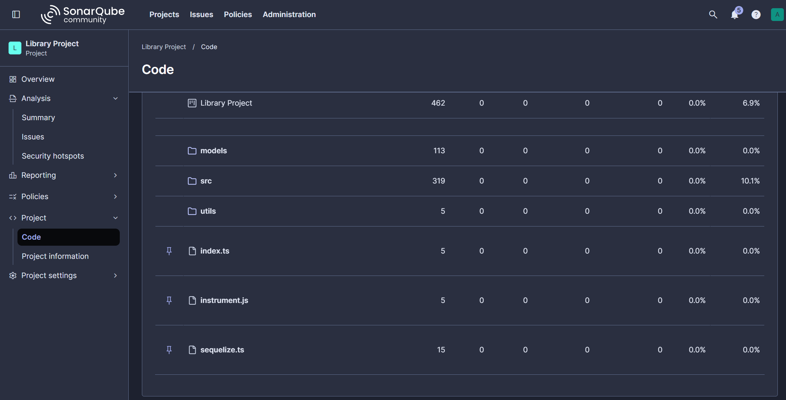
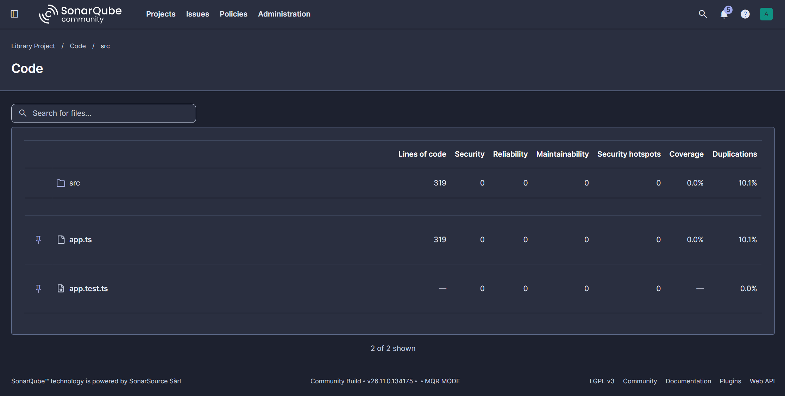

# Easy

## Exercise 1

docker ps shows a list of all the containers running. Each one shows the ID, the image, the name, how long it has been running, its status and the port.
The STATUS column tells you that sonarqube is running, Up 4 minutes (it has been running for 4 minutes). The PORTS column says 0.0.0.0:9000->9000/tcp which tells us that sonarqube is running on port 9000.

Docker keeps sonarqube separate from the rest of my computer, so i dont have to install programs it needs. So I can start and remove it with one command. My compose file lets me run the same setup on another computer.

## Exercise 2

My project passed the quality gate with 1 issue. 

The issue I got was "Promises must be awaited, end with a call to .catch, end with a call to .then with a rejection handler or be explicitly marked as ignored with the `void` operator". The code in question was my testDBConnection function I created during the sequelized assignment. To fix the issue, I would need to add void in front of the call.

## Exercise 3

**ISSUE 1:**

rule name: Promises should not be left unhandled (typescript:S9383)
file name: src/app.ts
line: L40
what is wrong: An async function is called without waiting for it. Errors can be missed and later code can run before the result is ready.
what compliant code would look like: void testDBConnection();
agree on problem: Yes because the error could happen later and my code would not notice.

**ISSUE 2:**

rule name: "Number.isNaN()" should be used to check for "NaN" value (typescript:S6679) 
file name: src/app.ts
line: L377
what is wrong: This is an old way to check for 'NaN'
what compliant code would look like: if(!Number.isNaN(count))
agree on problem: Yes because a value compared to itself will always be true unless it is 'NaN'. This can be confused and Number.isNaN() is more clear.

**ISSUE 3:**

rule name: "if/else if" chains and "switch" cases should not have the same condition (typescript:S1862)
file name: src/app.ts
line: L382
what is wrong: I used the same conditions in an if/else if chain, meaning that the second one will never run because the first one already caught it.
what compliant code would look like: 
if (count > 1) { 
  console.log ("a") 
} else { 
  console.log("b") 
}
agree on problem: Yes because the second one can never run. It makes the code confusing and adds extra code for no reason.

**Security:** Code that could let someone do harm.
Example: a password written in the code.

**Reliability:** Code that could break or act wrongly.
Example: calling 'testDBConnection()' without handling the promise, so an error could be missed.

**Maintainability:** Code that works, but is hard to read.
Example: a very long function that does too many things.

Sonarqube reads code without running it. It finds risky or messy code.
Tests run my code. They find when something gives the wrong result.
Sentry sends a report when a real user gets an error in the live app.

# Medium

## Exercise 4

**Sonarqube token:** Someone could log in as me to my sonarqube and see my project issues and change or delete things.

**Database password:** They could read, change or delete all the data in my database.

**Sentry DSN:** They could send fake errors to my sentry so my real errors get lost in all the errors.

The settings are saved in one file so I dont have to type or copy a long commande each time. It is shorter and easier to read and everyone on the team uses the same settings. The secrets stay out of the file and in .env.

## Exercise 5

**Code**: files scanned before adding exclusions, tests and test inclusions:

**Code**: files scanned after adding exclusions, tests and test inclusions:

**The difference:** only app.test.ts changes. Before it counted 22 lines of code. After I indicated which files are tests, it didn't count them. app.ts stayed the same. The lines are no longer counted because sonarqube now sees app.test.ts as a test file, not as code.

If the list includes code I didn't write, like node_modules, I can't fix it as it belongs to someone else and the changes will disappear next time npm install is run. Also it hides real issues as it would be messy to know which ones are because of my code and which ones aren't.

## Exercise 6

I don't have anymore issues to fix. I only had one issue at the beginning of the assingnment. I created two more for a different exercise.

npm run test is still green with the tests I added.