# Skill 1:

## 1. What does Sequelize translate, and from what into what?

It helps our JS code talk to our db without having to write complicated SQL queries directly. 
It makes db interactions much easier.
'SELECT * FROM books' -> Book.findAll();

## 2. What does ORM stand for? What is the "object" and what is the "relational" part?

Object Relational Mapper.
The 'object' part refers to the db tables.
The 'relational' part refers to model associations. Just like SQL, Sequelizes also has one-to-one, one-to-many and many-to-many relationships. But instead uses methods like hasOne(), hasMany(), belongsToMany() ...etc.

## 3. Write the SQL that Book.findAll() runs. Then write the SQL for Book.findByPk(3)

'SELECT * FROM books' -> Book.findAll();
The method finds all from Book.
'SELECT * FROM books WHERE id = 3' -> Book.findByPk(3)
The method finds by the primary key: So in this case book that has the id of 3.

## 4. In new Sequelize(...) , what does each of these do: host , port , dialect , logging ?

These are in a JavaScript Object that tell extra information to sequelize. It tells it what kind of db it is and where to find it:
- host -> is the address
- port -> is the door number
- dialect -> what kind of db we are using
- logging -> (optional), when true it will print out all SQL queries it is running. It is currently set to false to keep the code clean. Setting it to true can be helpful when debugging.

## 5. What does sequelize.sync() do? What would sequelize.sync({ force: true }) do, and why should you never use it on a database with real data?

If there is no table, sequelize.sync() will create the table (does nothing if it already exists).
sequelize.sync({ force: true }) -> Creates the table and drops the first if it already existed. This is not designed to be used on a db with real data as it may lead to data loss.

## 6. Name one situation where writing plain SQL is better than using an ORM.

When more complex queries are needed.

# Skill 4, part B:

Q. why does the loan date belong in the loans table, and not in
books or members ?

A. The loan date belongs in the loans table as the date describes the borrowing and not the book or member.

# Screenshots of each route working in Insomnia:

## 01 - Get "/books"

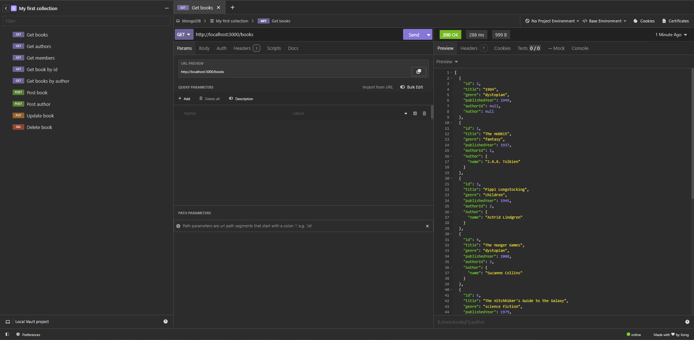;

## 02 - Get "/authors"

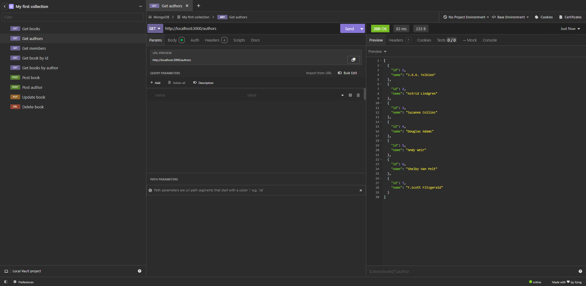;

## 03 - Get "/members"

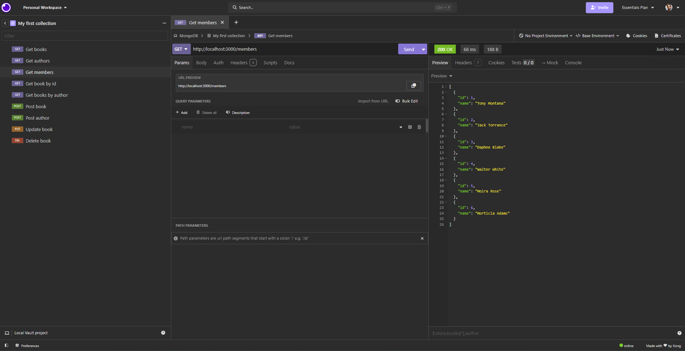;

## 04 - Get "/loans"

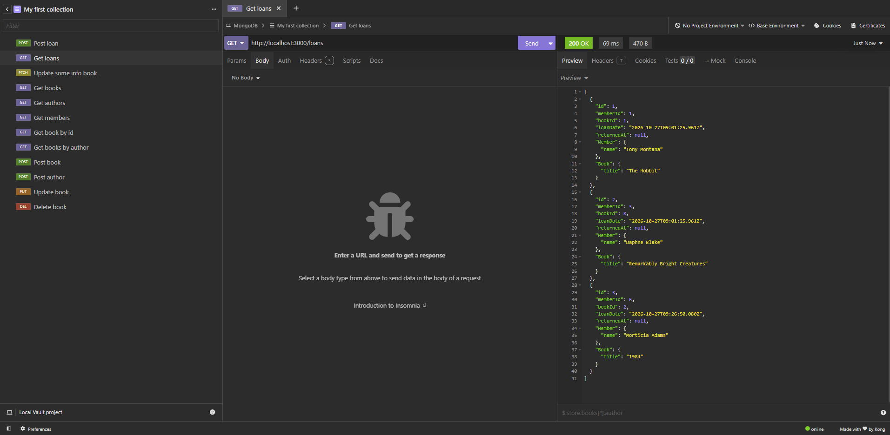;

## 05 - Get "/books/:id"

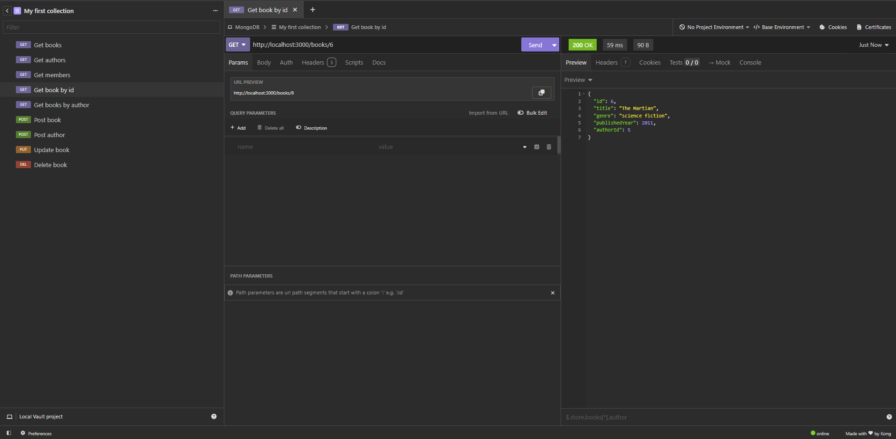;

## 06 - Get "/members/:id/loans"

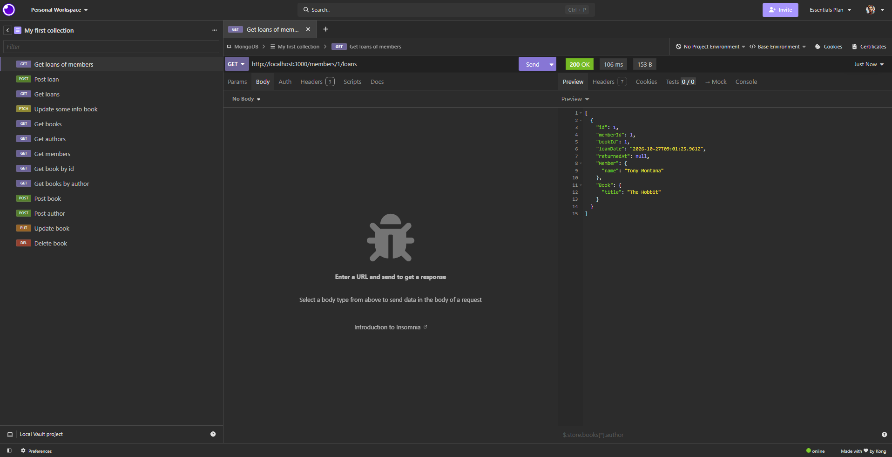

## 07 - Get "/authors/:id/books"

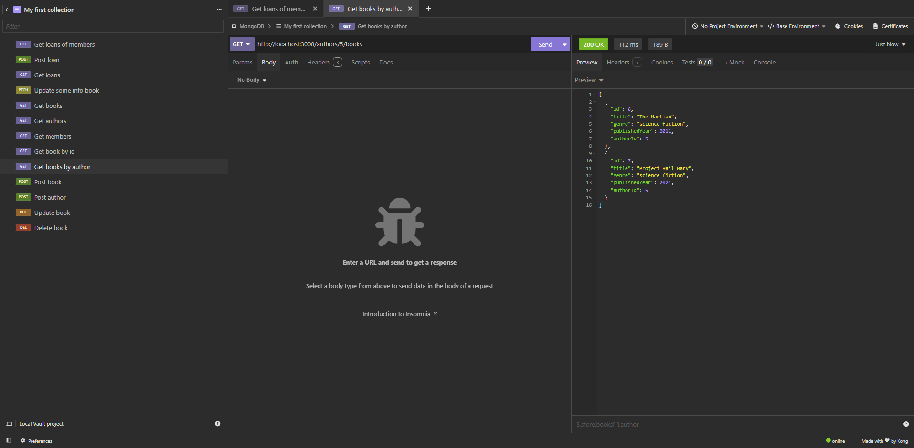

## 08 - Post "/books"

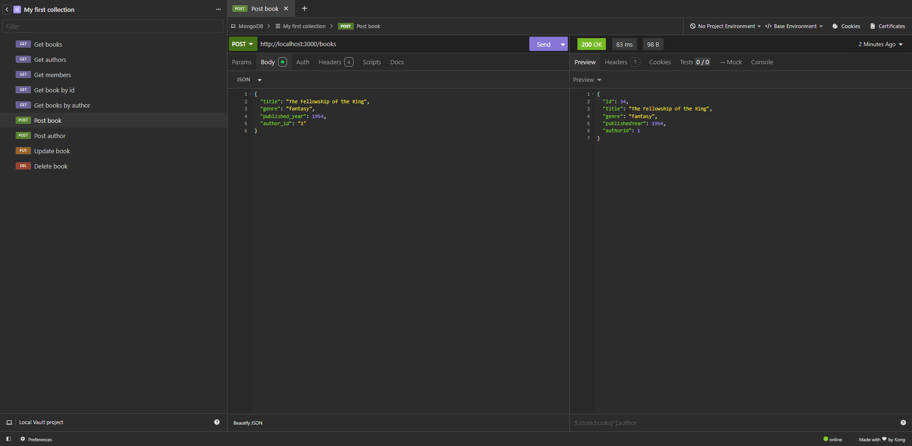

## 09 - Post "/authors"

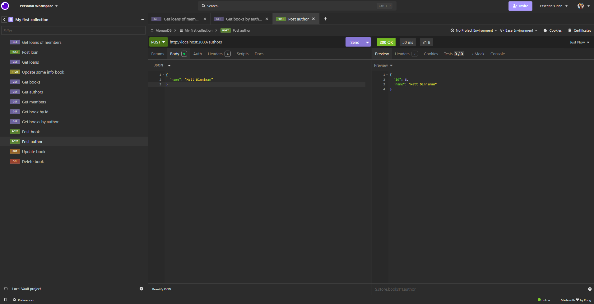

## 10 - Post "/loans"

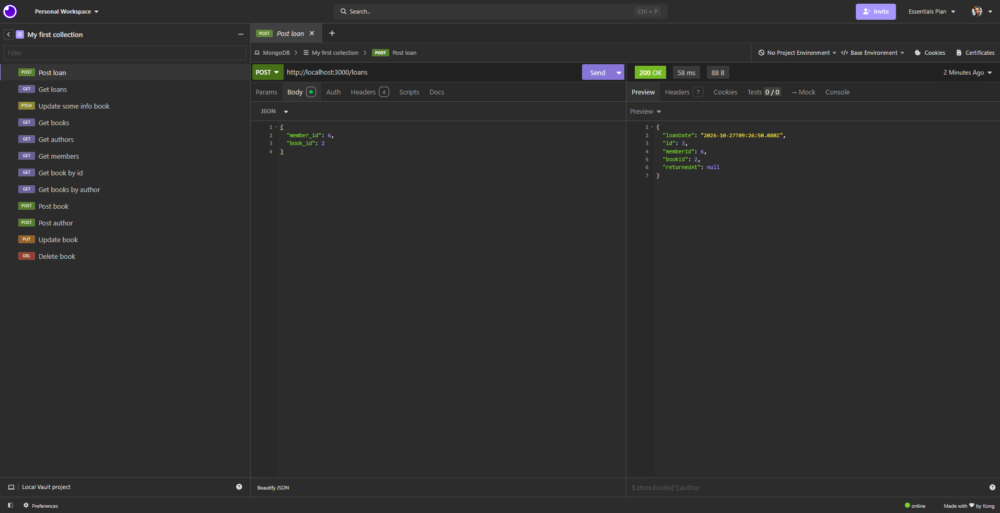

## 11 - Put "/books/:id"

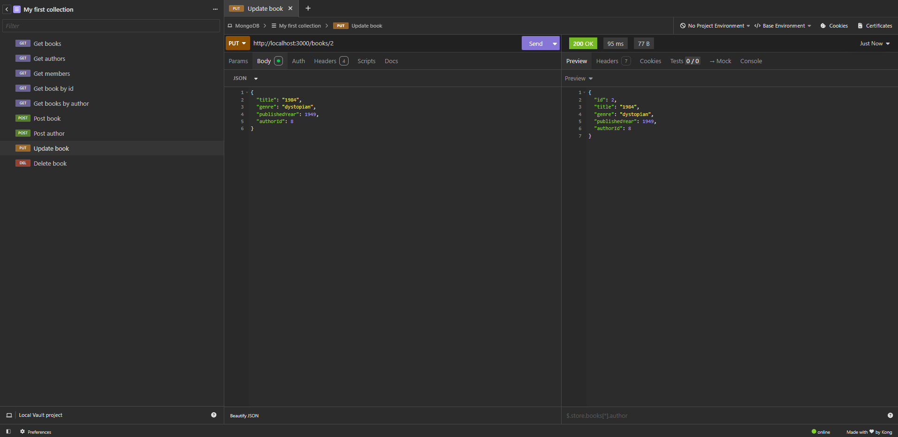

## 12 - Patch "/books/:id"

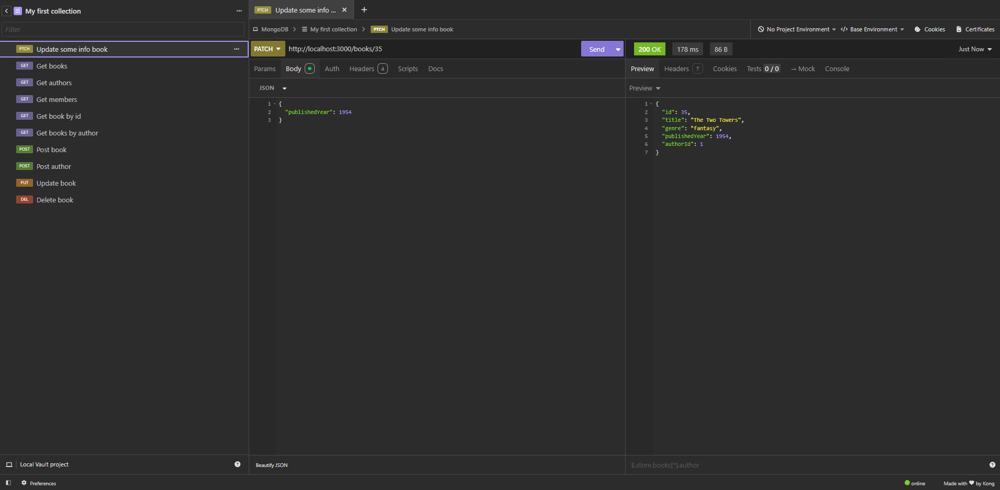

## 13 - Delete "/books/:id"

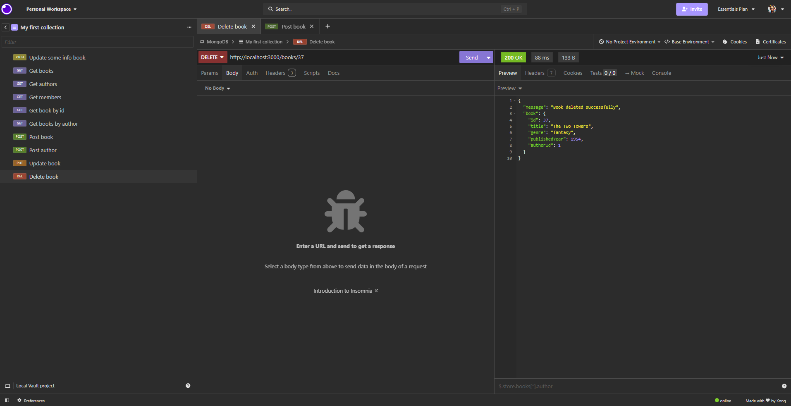