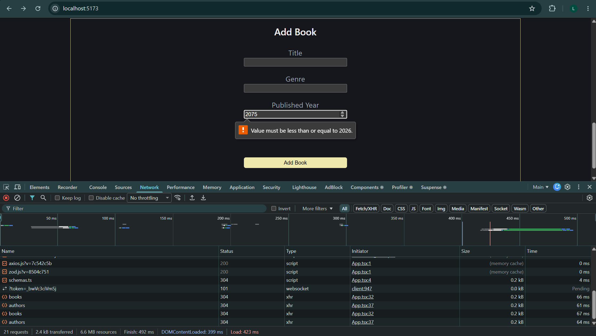

# Easy

## Exercise 1:

The API and the client are two separate programs. Each needs its own packages, so each has its own `package.json`. If react was in the API's `package.json`, the two projects would get mixed up. The API would also have packages it would never use.

While you run `npm run dev`, Vite starts the local server for the react app and when changes are made inside a file, the browser updates by itself.

## Exercise 2

I took a screenshot but it was an error of the wrong port (I used 3001 instead of 3000). I only saw this after installing cors. So when I tried to comment out `app.use(cors({ origin: "http://localhost:5173" }));`, it wasn't working (to get the screenshot of the CORS error), even after restarting the server and refreshing the page. I then decided to change the localhost to see if I could get the error and I did.

CORS is a safety check that the browser does. The client (localhost:5173) asked the API (localhost:3001) for data. The browser saw two different addresses and asked the API if it was allowed. The API had not said yes yet, so the browser blocked the request. Insomnia is not a browser, so it does not do this check.

If any origin is allowed, any website can use my API. With one origin, only the client is allowed. When the frontend is put online, then the origin would need to be changed to the real web address of the site.

## Exercise 3

React uses key to know which item in the list is which. `book.id` is unique and never changes. `index` is just the positionm, so if a book is deleted, the books under will get a new index as they move up a position. Items can then get mixed up.

`useState` stores the books in the component. When the books change, the page updates. `useEffect` runs code when the page loads. Here it gets the books from the API. Without `[]`, it runs again every time the page updates. Getting the books updates the page so it get the books again and again ..etc.

# Medium

## Exercise 4

A form normally reloads the page when you submit it. `event.preventDefault()` stops that. Without it, the book still gets added but the page reloads.

The database links a book to an author with the id so the API needs the id. Names can be spelled in different ways but the id is always the same.
If the user typed the `author_id` by hand, the wrong id could be entered that doesn't match the author or that doesn't exist.

If someone changes the rules in one place but forgets the other, the client and the API disagree. The form could accept a book that the API rejects or the other way around. Keeping the rules in one place would avoid this and a shared file for both could help.

